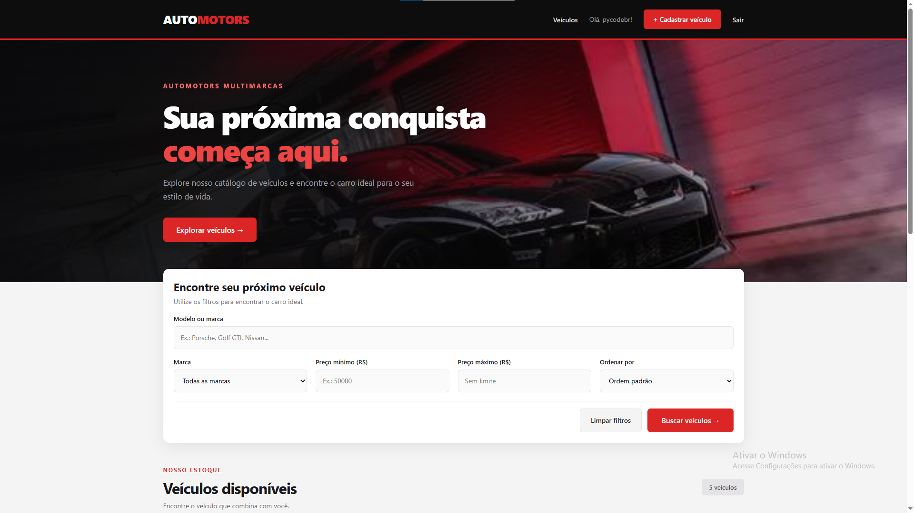
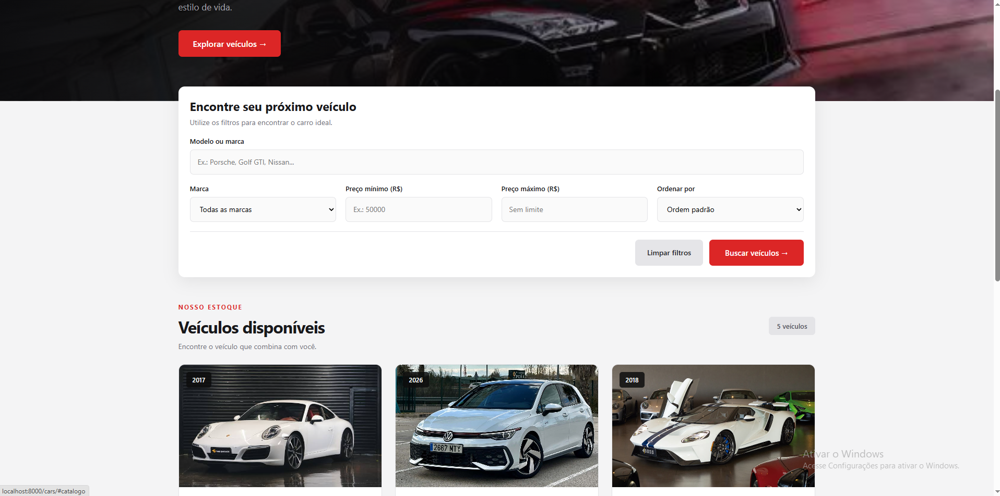
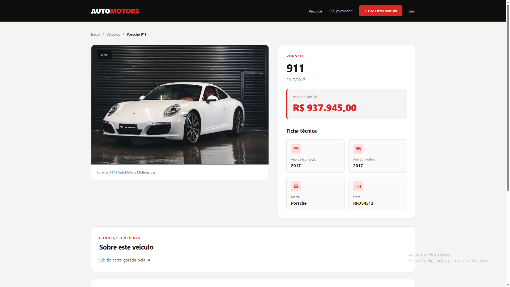
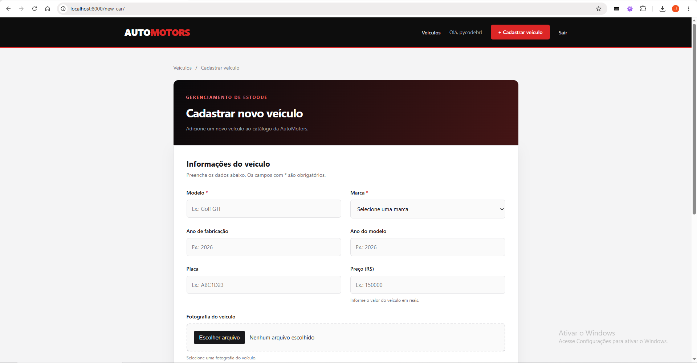
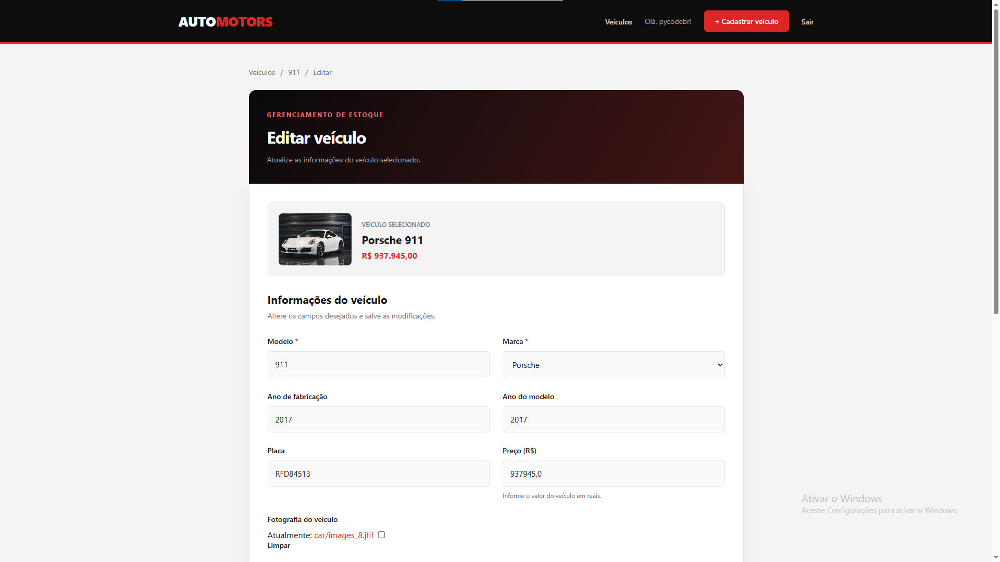
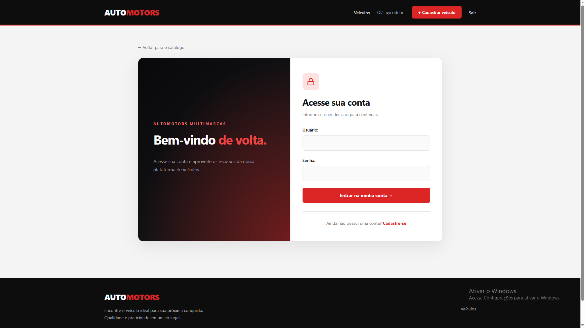
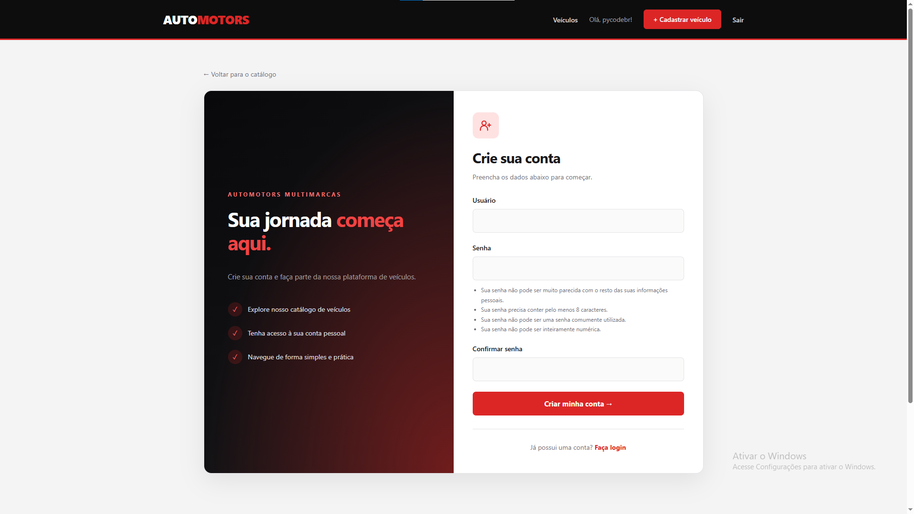
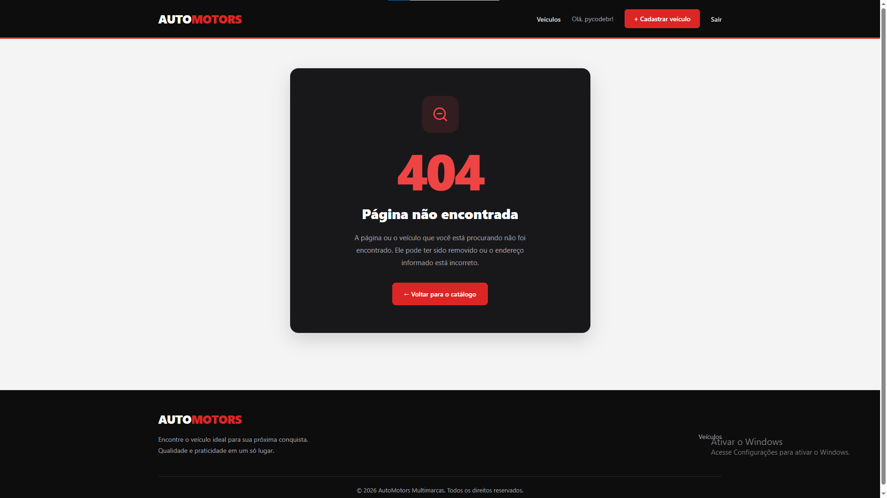

# 🚗 AutoMotors — Gerenciamento de Veículos


## 📌 Sobre o projeto

O AutoMotors é uma aplicação web para gerenciamento e comercialização de veículos, desenvolvida com Python e Django.

O projeto foi desenvolvido com o objetivo de aplicar conceitos de desenvolvimento Back-end, integração com banco de dados, autenticação, controle de permissões, inteligência artificial, testes automatizados e implantação em ambiente de produção.

A aplicação permite que clientes consultem o catálogo de veículos e que usuários autorizados realizem o gerenciamento do estoque.



## 🚀 Funcionalidades

- Cadastro, visualização, edição e exclusão de veículos (CRUD).
- Cadastro e autenticação de usuários.
- Controle de acesso baseado em permissões.
- Pesquisa por modelo e marca.
- Filtros por marca e faixa de preço.
- Ordenação de veículos por preço, modelo e ano.
- Paginação do catálogo.
- Upload e pré-visualização de imagens.
- Validação de formulários.
- Atualização automática do inventário.
- Integração com inteligência artificial para geração de descrições.
- Tratamento de falhas na API de inteligência artificial.
- Páginas personalizadas de erro 403 e 404.
- Interface responsiva.
- 36 testes automatizados.

## 🛠️ Tecnologias utilizadas

| Tecnologia | Finalidade |
|---|---|
| Python | Desenvolvimento Back-end |
| Django | Framework web |
| PostgreSQL | Banco de dados relacional |
| Django ORM | Manipulação do banco de dados |
| HTML5 | Estrutura das interfaces |
| CSS3 | Estilização e responsividade |
| JavaScript | Interatividade dos formulários |
| OpenAI API | Geração de descrições de veículos |
| Python-dotenv | Gerenciamento de variáveis de ambiente |
| Git | Controle de versionamento |
| GitHub | Hospedagem do código-fonte |
| AWS EC2 | Infraestrutura de implantação |
| Nginx | Servidor web e proxy reverso |
| uWSGI | Servidor de aplicação |

## 📸 Demonstração do sistema

### Catálogo e filtros avançados



### Detalhes do veículo



### Cadastro de veículos



### Edição de veículos



### Autenticação de usuários



### Registro de usuários



### Página personalizada de erro 404



## 🧠 Conceitos aplicados

- Programação Orientada a Objetos (POO).
- Arquitetura MVT (Model, View, Template).
- Class Based Views (CBVs).
- Django ModelForms.
- Django ORM.
- Django Signals.
- Relacionamentos entre modelos.
- Autenticação e autorização.
- Validação de dados.
- Integração com APIs externas.
- Tratamento de exceções.
- Separação de responsabilidades.
- Testes automatizados.
- Gerenciamento de variáveis de ambiente.

## 🔐 Segurança

O projeto utiliza recursos de segurança do Django e boas práticas de desenvolvimento:

- Proteção de credenciais por variáveis de ambiente.
- Arquivo `.env` excluído do versionamento.
- Autenticação de usuários.
- Controle de permissões para operações administrativas.
- Proteção CSRF nos formulários.
- Validação de dados no Back-end.
- Configuração de DEBUG por variável de ambiente.
- Tratamento de erros de acesso.

## 🤖 Integração com inteligência artificial

O AutoMotors possui integração com a API da OpenAI para gerar automaticamente descrições de veículos com base nas informações cadastradas.

A integração foi desenvolvida para preservar descrições existentes e permitir que o cadastro continue funcionando mesmo quando a API estiver indisponível.

A utilização da inteligência artificial é opcional e depende da configuração de uma chave válida da API.

## 📂 Estrutura do projeto

```text
carros/
├── accounts/
│   ├── static/
│   ├── templates/
│   └── views.py
├── app/
│   ├── templates/
│   ├── settings.py
│   ├── urls.py
│   └── wsgi.py
├── cars/
│   ├── migrations/
│   ├── static/
│   │   └── cars/
│   │       ├── css/
│   │       ├── images/
│   │       └── js/
│   ├── templates/
│   ├── forms.py
│   ├── models.py
│   ├── signals.py
│   ├── tests.py
│   └── views.py
├── docs/
│   └── screenshots/
├── openai_api/
│   └── client.py
├── .env.example
├── .gitignore
├── manage.py
├── requirements.txt
└── README.md
```

## ⚙️ Como executar o projeto

### Pré-requisitos

- Python compatível com as dependências do projeto.
- PostgreSQL.
- Git.

### 1. Clonar o repositório

```bash
git clone https://github.com/JoaoEmanoell/carros.git
cd carros
```

### 2. Criar o ambiente virtual

```bash
python -m venv venv
```

Windows (PowerShell):

```powershell
.\venv\Scripts\Activate.ps1
```

Linux:

```bash
source venv/bin/activate
```

### 3. Instalar as dependências

```bash
pip install -r requirements.txt
```

### 4. Configurar as variáveis de ambiente

Crie um arquivo `.env` utilizando o `.env.example` como referência.

```env
SECRET_KEY=sua_chave_secreta
DEBUG=True
ALLOWED_HOSTS=localhost,127.0.0.1

DB_NAME=carros
DB_USER=postgres
DB_PASSWORD=sua_senha
DB_HOST=localhost
DB_PORT=5432

OPENAI_API_KEY=
```

Crie o banco de dados `carros` no PostgreSQL e configure as credenciais correspondentes.

A chave da OpenAI é opcional.

### 5. Executar as migrações

```bash
python manage.py migrate
```

### 6. Criar um superusuário

```bash
python manage.py createsuperuser
```

### 7. Iniciar o servidor

```bash
python manage.py runserver
```

Acesse:

- Catálogo: http://127.0.0.1:8000/cars/
- Administração: http://127.0.0.1:8000/admin/

Utilize o painel administrativo para cadastrar as marcas dos veículos e gerenciar usuários e permissões.

## 🧪 Testes automatizados

O projeto possui 36 testes automatizados, abrangendo:

- Operações CRUD.
- Controle de permissões.
- Pesquisa e filtros.
- Ordenação e paginação.
- Validação de formulários.
- Atualização do inventário.
- Páginas de erro personalizadas.
- Integração com inteligência artificial.
- Tratamento de falhas da API.

Para executar os testes:

```bash
python manage.py test cars -v 2
```

Resultado da última execução local:

```text
Ran 36 tests in 1.679s

OK
```

## ☁️ Deploy

O projeto utiliza como referência de infraestrutura:

- AWS EC2.
- Linux Ubuntu.
- Nginx.
- uWSGI.
- PostgreSQL.
- Systemd.

A implantação da versão modernizada está prevista como próxima etapa do projeto.

## 📈 Melhorias futuras

- Desenvolvimento de uma API REST.
- Implementação de Docker.
- Pipeline de CI/CD com GitHub Actions.
- Ampliação da cobertura de testes.
- Melhorias de desempenho.
- Monitoramento da aplicação.
- Dashboard administrativo de estoque.

## 👨‍💻 Autor

**João Emanoel Lopes**

Desenvolvedor Python Back-end em formação, com foco em Python, Django, SQL e desenvolvimento de aplicações web.

- [GitHub](https://github.com/JoaoEmanoell)
- [LinkedIn](https://www.linkedin.com/in/joão-emanoel-lopes-1685241a2/)

---

Projeto desenvolvido para aprendizado, aprimoramento técnico e composição de portfólio profissional.
